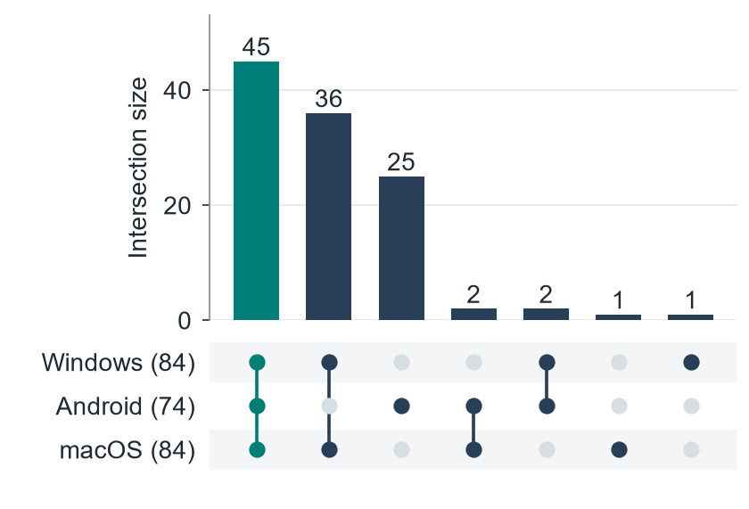

# DDR across operating systems

Research artifacts for **From DDR Advertisements to Encrypted DNS: System Policies, Upgrade Availability, and Resolver Continuity**.

This repository contains measurement code, October 2026 data, and the scripts used to generate the paper's figures. The study combines native Windows 11, Android, and macOS experiments with Internet measurements from Singapore and Los Angeles. The Internet probes implement the connection rules established by the native experiments.

[中文说明](docs/README.zh-CN.md) · [Data guide](docs/DATA.md) · [Measurement code](docs/MEASUREMENT.md) · [Figure reproduction](docs/FIGURES.md)

## Main results

| Measurement | Result |
| --- | ---: |
| Original resolver addresses with a valid, nonempty SVCB answer during endpoint validation, across both sites | 351,897 |
| Addresses completing the Windows DoH profile | 84 |
| Addresses completing the Android DoH profile | 74 |
| Addresses completing the macOS DoH profile | 84 |
| Addresses completing at least one DoH profile | 112 |
| Addresses completing all three DoH profiles | 45 |
| Addresses completing the Windows DoT profile | 80 |
| Original resolvers with stable DNS64 loss after encrypted upgrade | 4 |
| Native macOS function and routing controls | 16 cases, 96 queries |

An address passes an encrypted profile when discovery, destination selection, certificate checks, and the DNS exchange all succeed. DoH requires HTTP 200 and a valid DNS response. The rule experiments change individual checks and combinations of checks; the functional experiments compare plaintext and encrypted responses for the same query.

## Reproduce the figures

Use Python 3.11 or newer from the repository root:

```sh
python -m venv .venv
# Activate the environment using the command for your shell.
python -m pip install -r requirements.txt
python scripts/make_figures.py
python zh/scripts/make_figures.py
```

These commands read the included data and write eight figures per language as PDF and PNG. The Chinese figures need a Chinese font listed in the [figure guide](docs/FIGURES.md). All figure inputs are included; rebuilding them does not contact measurement targets.

Check the included counts and figure hashes without installing dependencies:

```sh
python scripts/verify_artifact.py
```

`data/SHA256SUMS` records the frozen input hashes; generated `data/derived.json` is checked through its source inputs.



## Repository layout

| Path | Contents |
| --- | --- |
| `data/` | Endpoint summaries, successful-address lists, rule and functional results |
| `measurement/validation/` | SVCB discovery, endpoint validation, DoT checks, and result analysis |
| `measurement/extensions/` | Rule interventions and paired DNS functionality experiments |
| `scripts/` | Shared figure generation code |
| `figures/`, `zh/figures/` | English and Chinese figures |
| `docs/` | Input formats, commands, and statistical definitions |

The paper denotes the original resolver address by **R₀**, the SVCB target name by **T**, and the encrypted destination by **F**. Historical data fields named `A` mean **R₀**; the DNS resource-record type `A` retains its usual meaning.

The three analysis tasks use their own recorded cohorts. The [data guide](docs/DATA.md) gives the denominators and explains how to recompute each result. A `round` field denotes a repeated query within the October campaign.

## Authors

Zundong Zhang, Hongtao Li, Junkai Wei, Zhaoxin Zhang, and Yanan Cheng.

## Acknowledgment

This work was supported by the Open Project of National Engineering Laboratory for Internet Domain Name Management Technology (No. K202511029), the Shandong Provincial Natural Science Foundation (No.ZR2024QF138), and the S&T Program of Shijiazhuang (No. 2561305107A).
